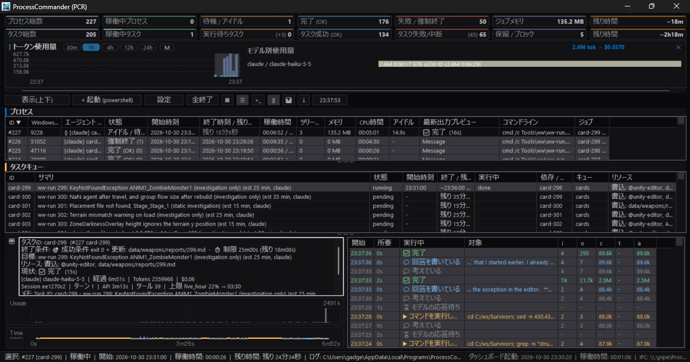
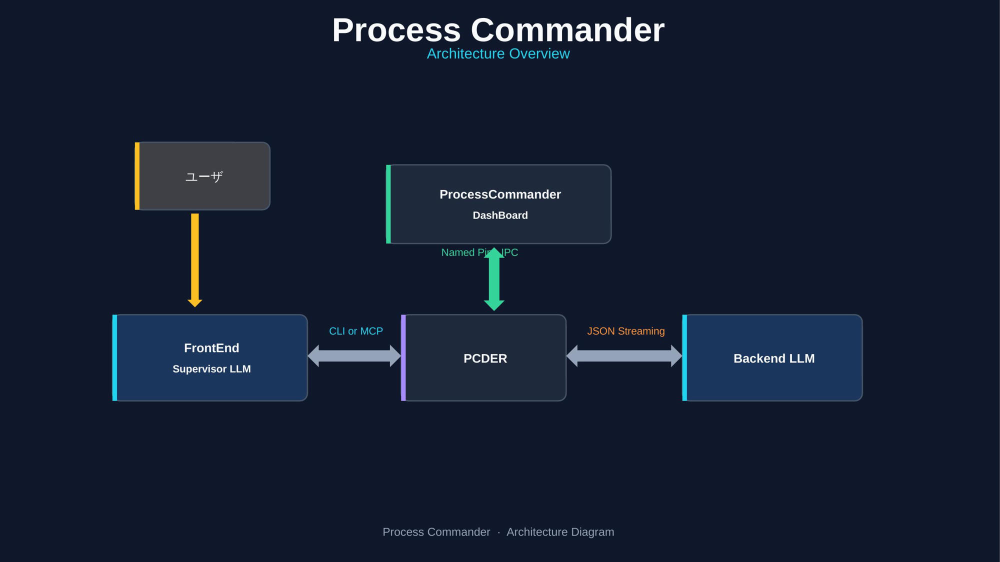

# ProcessCommander

**[English](README.md) | [Japanese](README-ja.md)**

**ProcessCommander** is a native Win32 C++ Multi-Terminal ConPTY Process Manager and Dashboard designed for orchestrating, monitoring, and interacting with multiple parallel CLI agents (`claude`, `opencode`, build scripts, and interactive shells) via both **Model Context Protocol (MCP)** and **CLI commands**.

**PCR** is short for ProcessCommander. Check the version with `pcder.exe --version` (current: 2.0.1).

### Who is this for?

- **Windows developers who use LLM coding agents** (Claude Code, opencode, Codex, etc.) and want one supervising LLM to delegate work to other CLI agents running as worker processes.
- **People running long, parallel, or interactive jobs** — builds, test suites, dev servers, TUI agents — that are too heavy, too slow, or too token-expensive for in-chat sub-agents.
- **Anyone who wants to watch and steer** many agent terminals live on one dashboard, with timeouts, retries, dependencies, and logs that survive restarts.

**Probably not for you if** your tasks are short reasoning or code edits that LLM sub-agents already handle well. See the [Pros/Cons comparison](doc/pros-cons-comparison.md).




The dashboard has an **execution monitor pane** below the process and task lists. It follows the selected process and shows its goal, what it is doing now, its TODO progress, job success condition, attempts and time limits, plus a plain-language activity history with elapsed times. JSON-streaming processes are marked `{}` in the process list. See [Key Features](doc/features.md) for details.



---

## Express

- Download and install [ProcessCommander-v2.3.3-win64-setup.exe](https://github.com/gadget114514/ProcessCommander/releases/download/v2.3.3/ProcessCommander-v2.3.3-win64-setup.exe)
  (portable: [ProcessCommander-v2.3.3-win64.zip](https://github.com/gadget114514/ProcessCommander/releases/download/v2.3.3/ProcessCommander-v2.3.3-win64.zip), all versions: [Releases](https://github.com/gadget114514/ProcessCommander/releases))
- In your llm, "find processcommander in PATH, then read help to use it" 
- In your llm, "create task and use (opencode|claude|agy|codex) to execute the task via processcommander" 
- That's all

LLM will execute "processcommander help --json", then the llm will know how to use it.
You use the LLM as frontend supervisor llm, and you can specify other llm as worker.


## Delegating to a worker LLM: `run_worker`

The MCP tool `run_worker` hands one task to a worker LLM CLI, blocks until the worker exits, and returns only its final result. The worker's transcript stays out of the supervisor's context, and the raw stream stays in `stream_file`.

```json
{
  "name": "run_worker",
  "arguments": {
    "cmd": "claude -p \"Summarize the failing tests\" --output-format stream-json --verbose",
    "name": "test-summary",
    "cwd": "D:/work/myproject",
    "timeout_sec": 1800
  }
}
```

| Argument | Meaning |
| :--- | :--- |
| `cmd` (required) | Worker command line, one command only |
| `name`, `cwd` | Dashboard label; working directory |
| `agent_type` | Stream format: `claude`, `agy`, `opencode` or `auto` (default: detected from the command) |
| `timeout_sec`, `idle_timeout_sec` | Kill after this runtime, or after this long with no output (0 = unlimited) |
| `supervisor_goal`, `supervisor_notes` | Text shown on the dashboard |
| `wait_ms` | Max wait in ms (default 0 = until the worker exits) |

The response carries `finished`, `success`, `state`, `exit_code`, `result`, `result_source`, `result_truncated`, `tool_calls`, `tool_errors`, `num_turns`, `permission_denials`, `total_tokens`, `cost_usd`, `log_file` and `stream_file`.

- `result` is capped at 64 KB; `result_truncated` tells you it was cut. If the stream has no result event, `result` holds the last output lines and `result_source` is `output`.
- If `wait_ms` runs out, the response has `finished: false` and the worker's current activity, and the worker keeps running. Continue with `wait_worker` and the returned `id`.
- Your harness does not see this as a native sub-agent. To have it shown as one, define a thin custom agent (Claude Code: `.claude/agents/<name>.md`, cheap model, this tool only) that calls `run_worker` and returns the result. The wrapper costs extra tokens; calling `run_worker` directly is cheapest.
- For several steps with an order, dependencies or retries, use the [task queue](doc/taskqueue.md) instead.

## Documentation

| Document | Contents |
| :--- | :--- |
| [Start](doc/start.md) | Quick start for LLM agents, build instructions, `ProcessCommander.exe` vs. `pcder.exe` |
| [Key Features](doc/features.md) | Dashboard GUI, shell launcher, history, tray, logs, Job Objects, settings, task queue overview |
| [Console CLI](doc/cli.md) | `pcder.exe` usage, JSON output, stdin modes, completion, `help --json` keys |
| [Task Queue](doc/taskqueue.md) | Ordered jobs, dependencies, job fields, states, ChainGuard |
| [MCP Server](doc/mcp.md) | MCP registration and the MCP tools |
| [Data Directory](doc/data-directory.md) | Project-local, git-managed `--data-dir` |
| [Pros/Cons](doc/pros-cons-comparison.md) | When to use ProcessCommander vs. sub-agents and alternatives |
| [tools/ww](tools/ww/README-ww.md) | Optional, independent task-card runner template (not part of ProcessCommander) |

---

## Release Notes

### v2.3.3
- **Themes**: added Deep Purple, Pale Purple, Deep Yellow and Pale Yellow.
- **List headers**: the background now has a slight tint of the theme accent colour.
- **Scrollbars**: the process and task list scrollbars are double-buffered to reduce flicker.
- **Settings**: fixed the sound section overlapping the buttons above it.

### v2.3.2
- **Themes**: five new pastel themes with pale backgrounds: Pastel Blue, Orange, Pink, Red and Green.
- **KPI cards**: the colour bar is twice as tall, the text is bold, and the cards are more compact.
- **CLI**: `pcder agent` is now `pcder worker`. The old name still works.
- **MCP**: `get_agent_stream`, `get_agent_state` and `update_agent_info` are now `get_worker_stream`, `get_worker_state` and `update_worker_info`. The old names still work but are no longer listed.

### v2.3.1
- **MCP**: `run_agent` and `wait_agent` are now `run_worker` and `wait_worker`, so they are not mistaken for your harness's native sub-agent feature. The old names still work but are no longer listed.

### v2.3.0
- **MCP**: added tools that hand one task to a worker LLM and return only its final result.
- **Monitor pane**: a tool call's description has its own column, and the subtask list takes two thirds of the width.
- **Task list**: hover to see the full Resources text, and copy cells.
- **ww-run**: finishes when the engine exits, not when its stdout closes.

Older versions: [Releases](https://github.com/gadget114514/ProcessCommander/releases)

## Appendix: `ProcessCommander.exe --help`

```text
ProcessCommander 2.0.1 - Native Win32 Multi-LLM Process & ConPTY Manager + Live GUI Dashboard

NAMING:
  PCR = ProcessCommander. "PCR" in docs, prompts or job notes means ProcessCommander
  (this executable); pcder.exe is its console client.

USAGE:
  ProcessCommander.exe [gui] [--data-dir <path>]
      Launch the live Win32 Dashboard GUI and Named Pipe server.

  ProcessCommander.exe mcp [--data-dir <path>]
      Run as a Model Context Protocol (MCP) stdio server for Claude.
      Automatically connects to (or launches) the Win32 GUI Dashboard.

  ProcessCommander.exe --help
      Show this help.

  ProcessCommander.exe --version
      Show the version.

OPTIONS (per launch):
  --data-dir <path>   Store logs, state, task queues and config in <path>.
                      Use a project-local directory to git-manage them. Each
                      data dir gets its own dashboard instance (separate pipe).
                      Equivalent environment variable: PROCESS_COMMANDER_LOG_DIR.
                      Consistency: pass the same --data-dir on every call, or embed
                      it once with `pcder.exe mcp install --data-dir <path>`.
                      Different data dirs are isolated dashboard instances.

WORKING MODEL (LLM orchestration):
  ProcessCommander is the execution layer for a supervising LLM.

    Supervisor LLM (Claude Code, opencode, ...)
      |  start_process   -> one long-running worker command
      |  taskqueue_add   -> ordered/dependent worker jobs
      v
    ProcessCommander
      |  owns processes, timeouts, logs, retries, state
      v
    Worker LLM / build command
      -> one job command; writes artifacts and logs

  Assumed structure:
    1. The supervisor plans and declares jobs. It does not run the work itself,
       does not chain commands, and does not fabricate success.
    2. Each unit of work is one job with a one-line summary, its own timeoutSec,
       and an optional success check (filesNewer / outputRegex). Steps or
       dependencies become separate jobs linked with dependsOn.
    3. Workers are ordinary processes and may themselves be LLM CLIs. Pass
       detailed instructions via instructionsFile/instructionsText; workers read
       {instructions} / PC_JOB_INSTRUCTIONS and write artifacts.
       Role clarity: when supervisor and worker share the same engine
       (Claude/Claude, opencode/opencode), roles can blur; prefer a different
       worker engine or a clearly distinct worker role/prompt.
    4. The supervisor observes with taskqueue_wait / taskqueue_list /
       taskqueue_graph and reads logs; it never polls .done files.
    5. On failure, fix the cause and call taskqueue_retry. Blocked dependents
       resume automatically.
    6. Keep the supervisor context small: read artifacts, not raw transcripts.

CONSOLE CLIENT / CLI SETUP:
  Use pcder.exe for CLI commands (start, list, logs, send, wait, kill, kill-all, clear).
  It auto-starts the GUI dashboard and locates ProcessCommander.exe in its folder.
  Run `pcder.exe help` for human-readable usage, or `pcder.exe help --json` for
  machine-readable commands and setup instructions for LLMs.

COMPLETION NOTIFICATION / BACKGROUND TASKS:
  `pcder.exe start ... --wait --wait-ms 0 --json` keeps pcder.exe alive until the
  managed process exits. `--wait-ms 0` means unlimited wait. Exit code is 0 on
  completion, the child exit code on failure, and 124 if the wait times out.
  For an existing process: `pcder.exe wait --id <id> --wait-ms 0 --json`.
  ProcessCommander also writes a .done JSON file on exit.

MCP SERVER SETUP:
  Register this executable in .mcp.json (Claude Code) or claude_desktop_config.json:
    {
      "mcpServers": {
        "process-commander": {
          "command": "<absolute path to ProcessCommander.exe>",
          "args": ["mcp"]
        }
      }
    }
  Auto-register (recommended for LLM agents):
    pcder.exe mcp install                    (writes .mcp.json in the current directory)
    pcder.exe mcp install --client opencode  (writes/updates opencode.json)

  PRECONDITIONS (LLM agents):
    - Windows 10/11 x64, same user session as the dashboard; no admin required.
    - The dashboard auto-starts on first use and owns the Named Pipe server.
    - Logs, state and task queues live under logs/ (override: PROCESS_COMMANDER_LOG_DIR).

  MCP tools (24):
    Process (6):
      start_process, list_processes, get_process_output, send_process_input,
      wait_process, kill_process
    Worker (5):
      run_worker, wait_worker, get_worker_stream, get_worker_state, update_worker_info
    Task queue (13):
      taskqueue_add, taskqueue_list, taskqueue_get, taskqueue_retry,
      taskqueue_update, taskqueue_cancel, taskqueue_pause, taskqueue_resume,
      taskqueue_wait, taskqueue_purge, taskqueue_link, taskqueue_unlink,
      taskqueue_graph

  HOW TO USE (decision guide):
    - One command, e.g. a build script, CLI worker or shell -> start_process
    - One task for a worker LLM, final result only         -> run_worker
      Harnesses do not see this as a native sub-agent; a thin custom agent that
      calls run_worker makes it one, at the cost of the wrapper's tokens.
    - Multiple steps, order, dependencies or retries      -> taskqueue_add + dependsOn
    - Never write &&, ||, a single &, PowerShell ';', newline chains or polling
      loops. ChainGuard rejects them: one job = one command with its own timeoutSec.
    - Required taskqueue job fields: id, command, summary, timeoutSec.
      Optional: cwd, env, dependsOn, idle, maxAttempts, retryDelaySec, success,
      killExclude, resources {write,read}, priority, instructionsFile / instructionsText.
    - resources: jobs whose write/read sets overlap never run together (read/read is
      fine). Paths/globs resolve against cwd; a bare file name (Foo.cs) means
      **/Foo.cs; "@name" is a named lock.
    - Success is verified: exit code AND optional filesNewer / outputRegex.
    - States: waiting = queued and ready; pending = dependencies not satisfied;
      blocked = a dependency failed; running; succeeded; failed; cancelled.
    - Observe with taskqueue_wait / taskqueue_list / taskqueue_graph; after fixing
      the cause use taskqueue_retry (blocked dependents resume automatically).

  For the full machine-readable guide (agent.quick_start, decision, states):
    pcder.exe help --json
```

---

## Appendix: `pcder.exe help` output

```text
pcder 2.0.1 - ProcessCommander console client

NAMING:
  PCR = ProcessCommander. "PCR" in docs, prompts or job notes means ProcessCommander
  (the GUI dashboard / MCP server, ProcessCommander.exe); pcder.exe is its console client.

USAGE:
  pcder [--json] <command> [options]

GLOBAL OPTIONS:
  --json, -j               Print machine-readable JSON instead of human-friendly text.
  -h, --help               Show this help.
  -V, --version            Show the version (also: pcder version).

DATA DIRECTORY (per invocation):
  --data-dir <path>        Store logs, state, task queues and config in <path> for
                           THIS pcder call. May be placed before or after the command.
                           Point it at a project folder to git-manage the data:
                             pcder.exe --data-dir .processcommander taskqueue add --file jobs.json
                             pcder.exe taskqueue list main --data-dir .processcommander
                           Each data dir gets its own dashboard instance, so different
                           projects can run at the same time.

  CONSISTENCY (one data dir per project):
    --data-dir is per invocation, not a global setting. To keep a project's
    logs/state/task queues consistent:
      1. Choose one project-local directory, e.g. .processcommander in the project root.
      2. Register the MCP server once with it:
           pcder.exe mcp install --data-dir .processcommander
         This writes "--data-dir .processcommander" into the project's MCP config,
         so every MCP tool call for the project uses the same directory.
      3. Pass the same --data-dir on every direct pcder call.
      4. Relative paths resolve against the caller's current directory. MCP clients
         normally start the server in the project root; if the cwd is uncertain,
         put an absolute path in the MCP config.
      5. Different data dirs are isolated (own dashboard instance, Named Pipe and
         mutex); they never share processes or queues.
      6. Verify: pcder.exe --data-dir <path> help --json prints
         "effective_data_dir", and the dashboard status bar shows the same path.

PCDER CONCEPTS:
  Process IDs : Numeric IDs assigned by the dashboard (#1, #2, ...). Use them with
                list --id, logs --id, send --id, wait --id and kill --id.
  Modes       : pipe    = anonymous pipes (default; non-interactive CLI workers)
                pty     = Win32 ConPTY (interactive TUI: opencode, claude)
                console = separate visible console window
  stdin       : pipe mode keeps stdin writable (pcder send) unless --close-stdin;
                close it for programs that wait for EOF.
  Logs        : logs/proc_<id>_<name>_<timestamp>.log (or --log-file).
  Done file   : atomic JSON on exit (logs/proc_<id>.done or --done-file) with
                state, exit_code, reason, log_file and done_file.
  cwd / env   : --cwd defaults to the caller's directory; PWD and INIT_CWD are
                set for the child and OLDPWD is removed.
  JSON output : --json / -j before or after the command prints one JSON object.
  Lifecycle   : start returns immediately unless --wait; use wait --id or the
                .done file to detect completion.

EXIT CODES:
  0    success / completed
  1    CLI or configuration error (also: process failure without --wait)
  124  wait timed out while the process is still running
       start --wait / wait return the managed process's exit code

ENVIRONMENT:
  PROCESS_COMMANDER_LOG_DIR   Override the logs directory (state, logs, queues).

EXAMPLES:
  pcder.exe list --json
  pcder.exe start --name build --cmd "cmd /c build.cmd" --timeout 1800 --wait --wait-ms 0 --json
  pcder.exe start --name tui --pty --cmd "opencode"
  pcder.exe logs --id 1 --tail 80
  pcder.exe send --id 1 --input "status"
  pcder.exe taskqueue add --file jobs.json --taskqueue main
  pcder.exe mcp install --client opencode

COMMANDS:
  list [--id <id>]
      List all managed processes and their live metrics.

  logs --id <id> [--tail <lines>] [--wait-ms <ms>] [--raw]
      Fetch process output logs (ANSI codes stripped by default unless --raw).

  start [options] -- <command...>
      Start a managed process (e.g. claude, opencode) under a Win32 Job Object.
      Options:
        --cmd "<command>"        Command line to execute
        --name <label>           Display name on dashboard (e.g. "opencode-worker")
        --mode <pty|pipe|console>
                                 pty     = Win32 ConPTY interactive session
                                 pipe    = Anonymous pipes (default; no ConPTY)
                                 console = Separate visible console window
        --pty                    Shortcut for --mode pty (enable ConPTY).
        --open-stdin             Pipe mode only (default): keep stdin writable for pcder send.
        --close-stdin            Pipe mode only: close stdin after launch so non-interactive
                                 programs (e.g. opencode run) receive EOF and can finish.
        --cwd <dir>              Working directory (default: the caller's current directory)
        --log-file <path>        Custom path for live output log
        --done-file <path>       Custom completion marker file created on exit
        --timeout <sec>          Max runtime timeout in seconds (0 = unlimited)
        --idle-timeout <sec>     Hang timeout if no output for N seconds (0 = unlimited)
        --eta <time>             Estimated end time shown in gray while running
                                 (e.g. "18:30" or "2026-10-22 18:30:00").
                                 If omitted, --timeout shows "remaining N seconds".
         --estimate-end <time>    Alias for --eta
         --agent-type <claude|agy|antigravity|opencode|codex|aider|ollama>
                                  Hint worker type for JSON stream parsing (auto-detected if omitted).
         --json-stream            Enable JSONL stream parsing and write <log>.stream.jsonl for LLM worker output.
         --wait                   Block until process exits (unlimited unless --wait-ms is set)
        --wait-ms <ms>           Max wait when --wait is set; initial output wait otherwise
                                 (default: 500; 0 = unlimited with --wait)

  send --id <id> --input "<text>" [--no-newline] [--wait-ms <ms>]
      Send input text to a running process's stdin or ConPTY session.

  wait --id <id> [--wait-ms <ms>]
      Wait until the specified process exits (or wait-ms elapses).

  kill --id <id>
      Forcefully kill the entire process tree (Job Object) for <id>.

  kill-all
      Forcefully kill all running managed process trees.

  clear
      Remove finished processes from the dashboard list.

  worker status <id>
      Show current worker status, active tool, thoughts, message, and supervisor context.

  worker stream <id> [--tail <n>] [--type <type>] [--since <seq>] [--summary]
      View captured JSON streaming events for claude, agy, or opencode workers.

  worker info <id> [--notes "<notes>"] [--goal "<goal>"]
      Update supervisor notes or goal for an ongoing worker.

  mcp install [--client claude|opencode] [--path <file>] [--name <name>] [--data-dir <path>] [--dry-run]
      Register ProcessCommander as an MCP server automatically. Writes or updates
      .mcp.json (Claude Code, default) or opencode.json (--client opencode).
      --data-dir embeds "--data-dir <path>" in the generated MCP server args so the
      project keeps its logs/state/task queues inside that directory.
      --json prints the machine-readable result; --dry-run previews without writing.

TASK QUEUE:
  taskqueue add --file <jobs.json> [--taskqueue <name>] [--concurrency <n>] [--notify-file <path>]
      Register jobs (array, or an object with "jobs"/"taskqueue"/"concurrency").
      Each job needs id, command, summary, timeoutSec; dependsOn replaces '&&'.
      Optional: cwd, env, dependsOn, idle, maxAttempts, retryDelaySec, success,
      killExclude, resources {write,read}, defer, priority, instructionsFile/instructionsText.
      resources: jobs whose write/read sets overlap (write/write, write/read) never
      run together, across all queues; read/read may. Paths/globs resolve against
      cwd; a bare file name (Foo.cs) means **/Foo.cs; "@name" is a named lock.
      Disable with Settings / config.json resource_locks.
      defer {exitCodes,delaySec,limit} (default [75], 60, 60): an attempt that exits
      with one of exitCodes ("nothing ran, try again later", e.g. ww-run refusing an
      overlapping card) goes back to pending after delaySec without using up
      maxAttempts; after limit deferrals (0 = no limit) it is an ordinary failure.

  taskqueue list [<name>] [--state <state>]
      List jobs with state, queue, summary and blockedBy.

  taskqueue get <id> [--rev <n>] [--no-instructions]
  taskqueue retry <id>
  taskqueue cancel <id>
  taskqueue pause|resume <name>
  taskqueue graph [<name>] [--root <id>]     (ready, waiting_for, resource_wait, retry_in_sec, blocked)
  taskqueue wait <name> [--since <version>] [--timeout-ms <ms>]
  taskqueue purge <name> [--states succeeded,failed,cancelled]

  start/run ... --allow-chain
      Allow a chained command (&&, ||, &, ';') as a single process. Task-queue
      jobs never allow chains; use dependsOn instead.

COMPLETION / BACKGROUND TASKS:
  Use --wait to keep pcder.exe alive until the managed process exits. Add
  --wait-ms 0 for an unlimited wait (or a positive value for a maximum).
  The exit code is 0 on completion, the child exit code on failure, and 124
  if the wait times out.

    pcder.exe start --name task --wait --wait-ms 0 --json --cmd "opencode run ..."
    pcder.exe wait --id <id> --wait-ms 0 --json

  ProcessCommander also writes a .done JSON file on exit. Without --wait,
  start returns immediately; poll the .done file or call wait.

SETUP FOR LLM AGENTS:
  CLI:
    Use pcder.exe (recommended) or the legacy "ProcessCommander.exe <command>" form.
    Run "pcder.exe help --json" to retrieve this help as machine-readable JSON.
    pcder.exe auto-starts the GUI dashboard on first use if it is not running.

  MCP (stdio):
    Register ProcessCommander.exe in .mcp.json (Claude Code) or
    claude_desktop_config.json (Claude Desktop):
      {
        "mcpServers": {
          "process-commander": {
            "command": "<path-to>\\ProcessCommander.exe",
            "args": ["mcp"]
          }
        }
      }

    AUTO-REGISTER (for LLM agents; no manual JSON editing):
      pcder.exe mcp install                    # .mcp.json (Claude Code)
      pcder.exe mcp install --client opencode  # opencode.json
      pcder.exe mcp install --path <file> --json --dry-run

    ORCHESTRATION MODEL (how an LLM should use this):
      A supervising LLM uses ProcessCommander as its execution layer to run
      child-process worker LLMs/CLIs as managed jobs.

        Supervisor LLM  ->  ProcessCommander  ->  Worker LLM / build command
        plans + declares    timeouts, logs,        one job command;
        jobs                retries, state         writes artifacts

      - The supervisor keeps its context small: it plans and declares jobs; it
        does not run the work itself, chain commands, or fabricate success.
      - One job = one command. Use start_process for a single worker; use
        taskqueue_add with dependsOn for multiple steps or dependencies.
      - Each job needs a one-line summary and its own timeoutSec. Pass detailed
        instructions via instructionsFile/instructionsText; the worker reads
        {instructions} / PC_JOB_INSTRUCTIONS and writes artifacts.
      - Workers may be LLM CLIs (opencode run, claude -p, ...) or build scripts.
      - Role clarity: when the supervisor and worker use the same engine
        (e.g. Claude supervising `claude -p`, or opencode supervising
        `opencode run`), roles can blur and cause confusion; prefer a
        different worker engine for workers, or give workers a clearly
        distinct role/prompt and avoid nested supervision.
      - Verify success with exit code + filesNewer/outputRegex; observe with
        taskqueue_wait / taskqueue_list / taskqueue_graph and logs; retry with
        taskqueue_retry. Blocked dependents resume automatically.
      - Never poll .done files; use taskqueue_wait or wait_process.
      - Delegating to a worker LLM: run_worker blocks until the worker exits and
        returns only its final result; the raw stream stays in stream_file.
      - Your harness does not see ProcessCommander as a native sub-agent. To have
        it shown as one, define a thin custom agent (Claude Code:
        .claude/agents/<name>.md, cheap model, this tool only) that calls run_worker
        and returns the result. The wrapper costs extra tokens; calling run_worker
        directly is cheapest.

    MCP tools (24):
      Process:    start_process, list_processes, get_process_output,
                  send_process_input, wait_process, kill_process
      Worker:     run_worker, wait_worker, get_worker_stream, get_worker_state,
                  update_worker_info
      Task queue: taskqueue_add, taskqueue_list, taskqueue_get, taskqueue_retry,
                  taskqueue_update, taskqueue_cancel, taskqueue_pause, taskqueue_resume,
                  taskqueue_wait, taskqueue_purge, taskqueue_link, taskqueue_unlink,
                  taskqueue_graph

NOTE:
  The GUI dashboard is provided by ProcessCommander.exe, which is auto-started
  on first use if it is not already running.
```
