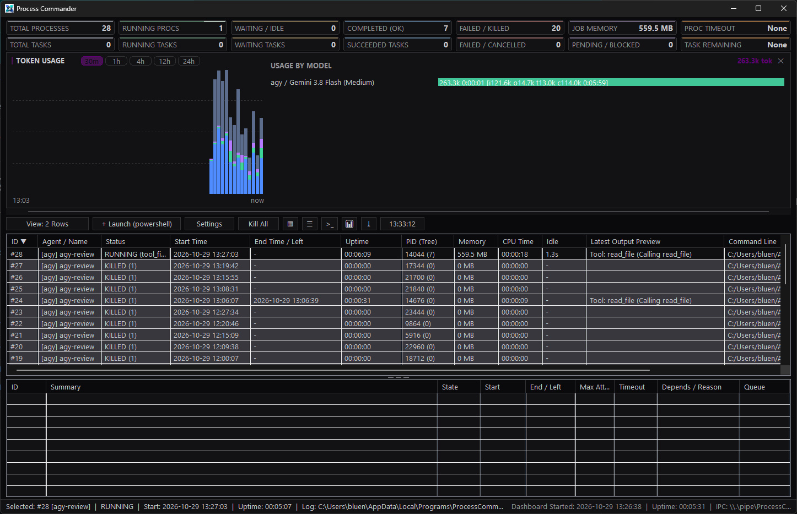
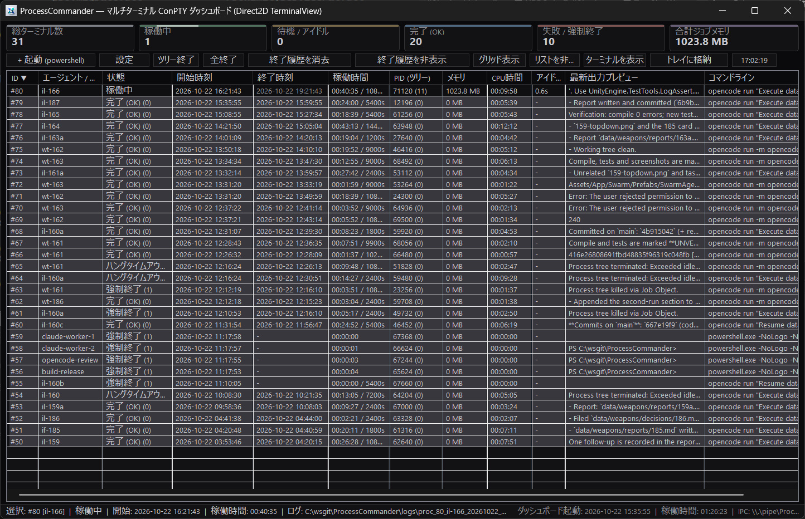
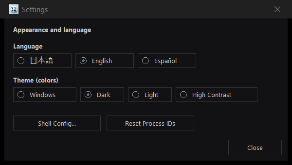

# ProcessCommander

**[English](README.md) | [Japanese](README-ja.md)**

**ProcessCommander** is a native Win32 C++ Multi-Terminal ConPTY Process Manager and Dashboard designed for orchestrating, monitoring, and interacting with multiple parallel CLI agents (`claude`, `opencode`, build scripts, and interactive shells) via both **Model Context Protocol (MCP)** and **CLI commands**.





---

## Express

- Install processcommander*setup.exe
- In your llm, "find processcommander in PATH, then read help to use it" 
- In your llm, "create task and use (opencode|claude|agy|codex) to execute the task via processcommander" 
- That's all

LLM will execute "processcommander help --json", then the llm will know how to use it.
You use the LLM as frontend supervisor llm, and you can specify other llm as worker.


## Quick Start for LLM Agents

```powershell
pcder.exe mcp install --client opencode   # or --client claude (writes .mcp.json)
pcder.exe help --json                     # machine-readable guide: see "agent.quick_start"
```

Rules of thumb (the same rules are encoded in `help --json`):

- **One command per job.** For multiple steps or dependencies use `taskqueue_add` with `dependsOn`; shell chains (`&&`, `||`, `&`, PowerShell `;`) and polling loops are rejected.
- **Timeouts are per job** (`timeoutSec`), never summed. Every job also needs a one-line `summary`.
- **Success is verified** by the exit code plus optional `filesNewer` / `outputRegex`, not merely "the process exited".
- **Watch the states**: `waiting` = queued and ready (waiting for a slot), `pending` = not queued yet (dependencies not satisfied), `blocked` = a dependency failed. Use `taskqueue_wait` / `taskqueue_graph`, and `taskqueue_retry` after fixing the cause.

---

## Project-Local Data Directory (git-managed)

Logs, process state, task queues and GUI config live in one **data directory**. Select it per invocation with `--data-dir <path>`:

```powershell
pcder.exe --data-dir .processcommander taskqueue add --file jobs.json
pcder.exe taskqueue list main --data-dir .processcommander
pcder.exe mcp install --data-dir .processcommander   # embed it in the project's MCP config
```

How consistency is guaranteed:

1. Pick one project-local directory, e.g. `.processcommander/`.
2. `pcder.exe mcp install --data-dir .processcommander` writes `--data-dir .processcommander` into `.mcp.json` / `opencode.json`, so every MCP tool call for that project uses the same directory.
3. Pass the same `--data-dir` on every direct `pcder.exe` call. It is **per invocation**, not a global setting.
4. Relative paths resolve against the caller's current directory; use an absolute path in the MCP config if the client's cwd is uncertain.
5. Different data directories are fully isolated: each gets its own dashboard instance, Named Pipe and mutex, so multiple projects can run at once without sharing processes or queues.
6. Verify with `pcder.exe --data-dir <path> help --json` (`effective_data_dir`) or the dashboard status bar, which shows the active data directory.

The environment variable `PROCESS_COMMANDER_LOG_DIR` is an equivalent fallback.

---

## Key Features

### 1. Native Win32 + Direct2D Multi-Terminal Dashboard GUI
- **14 Top KPI Summary Cards (Two Rows: Processes & Task Queues)**:
  - **Compact Horizontal Layout**: Labels and numbers are placed side-by-side on a single line, minimizing header height to maximize vertical space for process lists and terminals.
  - **Top Row (Processes)**: Real-time metrics for Total Terminals, Active Running, Waiting/Idle (no output or CPU activity for `>= 10s`), Completed (`Exit 0`), Failed/Killed, **Shortest Remaining Time** (live countdown of nearest active process timeout), and Total Job Object Memory & Process Count.
  - **Bottom Row (Tasks)**: Real-time metrics for Total Tasks, Active Running, Waiting/Pending, Succeeded, Failed, **Shortest Remaining Time** (live countdown of nearest active task timeout), and Active Queues / Concurrency summary.
  - Hover over any card for detailed tooltips and breakdown counts.
- **Two-Row Stacked Layout with Draggable Splitter**:
  - View both the **Process Summary Table** (top) and **Task Queue Table** (bottom) simultaneously in a dual-row view.
  - Interactive **draggable horizontal splitter bar** between the two tables allows smooth resizing of their relative heights.
  - **View Mode Cycling (`Ctrl+T` / View Toggle Button)**: Cycle between **Two Rows** (Processes + Tasks), **Processes Only**, and **Tasks Only** at any time.
- **Sortable Process Summary Table (Newest on Top)**:
  - Newly launched processes are automatically added to the **top of the list** (`ID ▼` descending by default).
  - Click **any column header** (`ID`, `Agent / Name`, `Status`, `Start Time`, `End Time`, `Uptime`, `PID (Tree)`, `Memory`, `CPU Time`, `Idle`, `Latest Output Preview`, `Command Line`) to toggle **Ascending (`▲`) / Descending (`▼`)** sort order.
  - **CPU-Aware Idle Detection**: While a process's CPU time keeps increasing, it stays `RUNNING` instead of being shown as `IDLE / WAITING`, and it is not killed by `--idle-timeout`. CPU time includes all processes in the Win32 Job Object tree.
- **Tab-Switched Full-Size Direct2D Terminal (`>= 80x25`)**:
  - Embedded hardware-accelerated Direct2D / DirectWrite / IME / Sixel VT terminal emulator (`TerminalView` + `ConPtySession`).
  - Switch between active terminals using the **Terminal Tab Bar** while always preserving at least **80 columns × 25 rows** of terminal viewport so TUI apps (`claude`, `opencode`, `vim`, `htop`) never wrap or corrupt their layout.
  - Type directly into the terminal (full keyboard input, `Ctrl+C`, IME composition, mouse wheel scrollback, and text selection).
- **Up to 16 Parallel Terminals in Live Grid View (`[▦]`)**:
  - Click **`[▦]`** on the toolbar to open a live DWM thumbnail & snapshot grid (up to **16 parallel terminals** in a `4×4` matrix). Click any cell or use arrow keys + Enter to jump directly to that terminal tab.
- **Compact Icon Buttons with Hover Tooltips**:
  - **`[▦]`** Grid View toggle
  - **`[☰]`** Hide/Show Process List toggle
  - **`[>_]`** Hide/Show Terminal Panel toggle
  - **`[⤓]`** Minimize to System Tray
  - All toolbar icon buttons provide instant status-aware hover tooltips.

### 2. Multi-Shell Launcher & `[Config]` Dialog (`cmd` / `powershell` / `bash`)
- Click **`[+ Launch (...)]`** on the toolbar to immediately spawn a new interactive ConPTY terminal tab.
- Open **`[Settings]`** → **`[Shell Config...]`** to select the default shell (`cmd`, `powershell`, or `bash` — auto-detecting Git Bash / WSL Bash), customize startup command lines, or launch any shell on the spot. Settings are persisted in `logs/config.json`.


### 3. History Management, Task Details & LLM JSON Tree Viewer
- **Hide Ended Processes** (Settings dialog): A convenient checkbox in the Settings dialog lets you toggle hiding/showing finished processes so you can focus exclusively on currently running tasks without deleting history.
- **`[Clear Ended]`** & **`[Reset Process IDs]`** (Settings dialog): Clear all completed/failed process history or renumber processes sequentially from `#1`.
- **Right-Click Context Menu & Task Details Dialog**: Right-click any process row or terminal tab (or double-click a row) to terminate the process tree (**`Kill Tree`** with confirmation), inspect full command lines, working directory, PID/Job metrics, log paths, `.done` files, and output preview, or copy commands to the clipboard.
- **LLM JSON Output Streaming & Interactive Tree Viewer**:
  - Native streaming event capture for major AI coding agents (`claude`, `agy`, `opencode`, `codex`).
  - Automatically captures structured event streams into `<logfile>.stream.jsonl` in addition to raw console logs.
  - The Task Details dialog features an embedded **JSON Tree Viewer** (powered by `nlohmann/json`): expand, collapse, and inspect hierarchical JSON payloads, tool inputs/outputs, thought blocks, and token usage without having to manually read raw JSONL streams.

### 4. System Tray Integration
- Click **`[⤓]`** (Tray icon button), minimize the window, or press the window close button (`[X]`) to hide ProcessCommander into the **Windows System Tray** while keeping all background ConPTY processes and IPC/MCP services running.
- Left-click or double-click the tray icon (or right-click to open the tray menu) to restore and expand the dashboard at any time.

### 5. Persistent Logs, State Recovery & `.done` Completion Marker Files
- **Real-Time Per-Process Logs**: Every process's stdout/ConPTY stream is continuously written to `logs/proc_<id>_<name>_<YYYYMMDD_HHMMSS>.log` (or a custom `--log-file <path>`).
- **Completion Marker Files (`.done`) for AI Agents**: On process exit, ProcessCommander atomically writes a JSON completion file (`logs/proc_<id>.done` or custom `--done-file <path>`), allowing Claude or automation scripts to detect task completion via simple file-existence checks.
- **State Persistence Across Restarts**: Process metadata and history are saved in `logs/processes_state.json` and automatically restored when ProcessCommander starts.

### 6. Reliable Win32 Job Object Process Tree Control
- Each process runs inside a dedicated Win32 `Job Object` (`JOB_OBJECT_LIMIT_KILL_ON_JOB_CLOSE`), tracking all child/grandchild processes and memory usage and guaranteeing clean tree termination on `kill`, `--timeout`, or `--idle-timeout`.

### 7. Settings Dialog, Theme & Localization
- Click **`[Settings]`** to open the settings dialog.
- **Language**: switch between **Japanese / English / Español** buttons; the dashboard, dialogs, menus, and status bar update immediately.
- **Theme (colors)**: **Windows** (default; follows the Windows light/dark mode and personalization accent color), **Dark**, **Light**, or **High Contrast**. Buttons, list headers (both process list and job queue list), scrollbars, and tab labels follow the active theme colors.
- **`[Shell Config...]`**, **`[Reset Process IDs]`**, **`[Clear Ended]`**, and **Hide Ended Processes** checkbox are available here (keeping the toolbar clean and focused).
- Settings, language, theme, list/terminal visibility, and layout are **auto-saved** to `logs/config.json` and restored on the next start.



### 8. Task Queue: Ordering, Dependencies, Timeouts and Automatic Retries
- Register jobs with **one command each**; ProcessCommander decides when to run them (concurrency, dependencies, priority) and persists the queue across restarts (`logs/taskqueues/<name>.json`).
- Per-job `timeoutSec`, idle detection (output **and** CPU), success checks (`exitCode`, `filesNewer`, `outputRegex`), automatic retries (`maxAttempts`), and `blocked` dependents when a dependency fails.
- **ChainGuard** rejects shell chains and wait loops in `start_process` / `taskqueue_add`; use `dependsOn` instead. CLI `--allow-chain` is the only escape hatch (never exposed over MCP).
- GUI: click the leftmost view mode toggle button or press **Ctrl+T** to cycle between **Two Rows** (Processes + Tasks), **Processes Only**, and **Tasks Only**. In Two Rows mode, drag the horizontal splitter bar to adjust relative heights. Running jobs are listed first and highlighted; failed rows are muted red and timed-out rows muted amber (theme-based, low saturation).
- See [Task Queue](#task-queue-ordered-jobs-dependencies-and-retries) for the data model and examples.

---

## Sub-Agent vs. ProcessCommander Execution

A short Pros/Cons analysis for choosing how to run work: **LLM-native sub-agents** vs. **ProcessCommander-managed CLI processes**.

### Sub-Agent Execution (LLM-native)

**Pros**
- Deep integration with the supervising LLM: shares context, reasons adaptively, uses tools, and can change plans mid-flight.
- No extra binary or setup; works wherever the LLM client runs.
- Ideal for short, reasoning-heavy, code-editing and exploratory tasks.
- Natural error diagnosis and retry with human-like judgment.

**Cons**
- Token- and cost-heavy for large/repetitive jobs; bounded by the context window.
- Poor fit for long-running, interactive, or process-tree-heavy workloads (builds, dev servers, TUI agents).
- Limited observability: no live terminal grid, idle detection, or job-object tree control.
- Concurrency and dependency orchestration are client-dependent and often implicit.
- Hard to persist or recover state across LLM session restarts.

### ProcessCommander Execution (external CLI processes)

**Pros**
- Runs real CLI agents/tools (`claude`, `opencode`, `codex`, build scripts) as managed OS processes with Win32 Job Object tree control.
- Live dashboard: up to 16 terminals, idle detection, per-job timeouts, retries, dependencies, and persisted task queues.
- `.done` markers and per-process logs enable simple, robust completion detection by LLMs/automation.
- Lower token cost for heavy work; the LLM acts as supervisor only.
- MCP + CLI integration and project-local data directories.
- State recovery across restarts.

**Cons**
- Windows-only; requires installation and setup.
- Processes are comparatively opaque: the LLM sees captured output, not internal reasoning.
- Task specs must be explicit (command, timeout, success checks).
- Adds operational complexity and resource overhead.
- Interactive debugging requires attaching via the dashboard.

### Recommendation

Use **sub-agents** for reasoning and code changes; use **ProcessCommander** for parallel, long-running, interactive, or build-heavy CLI workloads. Best of both: let the LLM supervisor delegate heavy jobs to ProcessCommander while sub-agents handle analysis and edits.

---

## Build Instructions

Requires Windows 10/11 (x64), Visual Studio 2022 (C++17), and CMake 3.20+:

```powershell
cmake -B build -G "Visual Studio 17 2022" -A x64
cmake --build build --config Release
```

Output binaries:
- `build/Release/ProcessCommander.exe` — GUI dashboard, Named Pipe IPC server, and MCP stdio server (alongside `conpty.dll` and `OpenConsole.exe`)
- `build/Release/pcder.exe` — Console CLI client

---

## Executables: `ProcessCommander.exe` vs. `pcder.exe`

| Executable | Role | Typical commands |
| :--- | :--- | :--- |
| `ProcessCommander.exe` | GUI dashboard, Named Pipe IPC server, and MCP stdio server. Owns all managed ConPTY processes. | `ProcessCommander.exe gui`<br>`ProcessCommander.exe mcp`<br>`ProcessCommander.exe help` |
| `pcder.exe` | Console client that sends requests to the running dashboard. No GUI of its own. | `pcder.exe list`<br>`pcder.exe start -- cmd.exe`<br>`pcder.exe help --json` |

- **`ProcessCommander.exe`** starts the dashboard with `gui` (the default if no command is given). If the dashboard is already running, `gui` restores it from the System Tray instead of starting a second instance. Use `mcp` to expose ProcessCommander as an MCP stdio server (it auto-starts the dashboard when needed).
- **`pcder.exe`** is the recommended console interface for humans, scripts, and LLM agents. It communicates with the dashboard over `\\.\pipe\ProcessCommander_IPC_v1`, auto-starts `ProcessCommander.exe` when the dashboard is not running, and locates the GUI binary in the same directory. Keep both `.exe` files together.
- **Legacy CLI compatibility**: `ProcessCommander.exe <command> [options]` forwards `start`, `list`, `logs`, `send`, `wait`, `kill`, `kill-all`, and `clear` to the same handler as `pcder.exe`. Prefer `pcder.exe` for new usage.
- **LLM discovery**: `pcder.exe help --json` is the canonical machine-readable guide. It includes `concepts` (IDs, modes, stdin, logs, `.done` files, cwd/env, data directory), `cli_exit_codes`, `environment_variables`, `common_examples`, `data_dir_option` with the resolved `effective_data_dir`, every command (including the `taskqueue` subcommands and `mcp install`), `setup.mcp.auto_install`, and an `agent` object with `working_model`, `data_dir_consistency`, `decision`, `states`, and `quick_start`.

---

## Usage 1: Console CLI (`pcder.exe`)

The console client `pcder.exe` communicates with the running GUI Dashboard via Named Pipe (`\\.\pipe\ProcessCommander_IPC_v1`). If the dashboard is not yet running, `ProcessCommander.exe` is located in the same directory and launched automatically.

### JSON Output (`--json` / `-j`)

By default, `pcder.exe` prints human-friendly text. Add the global `--json` (or `-j`) flag — before or after the command — to receive the raw machine-readable JSON response instead. This is intended for scripts, CI pipelines, and LLM agents:

```powershell
# List all managed processes as JSON
pcder.exe list --json

# The flag can also precede the command
pcder.exe --json logs --id 1 --tail 80

# Short form
pcder.exe wait --id 1 --wait-ms 30000 -j
```

Every response is a single JSON object written to stdout. Successful responses contain `"ok": true` (for example, `list` returns an `ok` flag and a `processes` array); errors contain `"ok": false` plus an `error` message and set the process exit code to `1`. With `--json`, errors are also emitted as JSON on stdout:

```json
{"ok":false,"error":"Process ID not found."}
```

Example `list` response (fields abbreviated):

```json
{"ok":true,"processes":[{"id":1,"name":"agent-task","command":"opencode","mode":"pty","state":"running","pid":12345,"exit_code":0,"elapsed_ms":5230,"tree_procs":3,"memory_bytes":48234496,"log_file":"C:/logs/task42.log","done_file":"C:/logs/task42.done","last_line":"..."}]}
```

The examples below show the default human-friendly output:

```powershell
# Launch the GUI Dashboard (or restore from System Tray if already running)
ProcessCommander.exe gui

# Start a process with ConPTY enabled (use --pty; pipe mode is the default)
pcder.exe start --name "agent-task" --pty --cmd "opencode run \"Fix issue #42\"" --log-file "C:/logs/task42.log" --done-file "C:/logs/task42.done"

# List all managed processes (human-friendly table)
pcder.exe list

# Read the latest 80 lines of clean output from process #1
pcder.exe logs --id 1 --tail 80

# Send input to process #1's ConPTY / stdin
pcder.exe send --id 1 --input "y"

# Wait for process #1 to finish (up to 30 seconds)
pcder.exe wait --id 1 --wait-ms 30000

# Kill a process tree or all running processes
pcder.exe kill --id 1
pcder.exe kill-all

# Clear finished process history
pcder.exe clear
```

By default, `pcder.exe start` uses **pipe mode**, which launches the process directly without ConPTY. Add `--pty` (or `--mode pty`) to enable ConPTY for interactive terminals, or use `--mode console` to launch a separate visible console window. The MCP `start_process` tool follows the same rule: `mode` defaults to `pipe`, and `pty: true` enables ConPTY.

In pipe mode, stdin remains writable by default so `pcder.exe send` can feed input. Non-interactive programs such as `opencode run` may wait forever for stdin EOF; pass `--close-stdin` to close stdin immediately after launch so they can finish:

```powershell
# Keep stdin open for interactive input via pcder.exe send
pcder.exe start --name "pipe-shell" --cmd "cmd.exe"

# Non-interactive program that reads stdin: close it so EOF is delivered
pcder.exe start --name "oc-run" --close-stdin --cmd "opencode run OK" --timeout 90
```

For an interactive TUI such as `opencode` (without `run`), prefer `--pty`. The MCP equivalent of `--close-stdin` is `open_stdin: false`.

While a process is running, the **End Time** column shows an estimated finish time in gray. Pass `--eta "18:30"` (or `--estimate-end`) to set it explicitly; otherwise `--timeout` makes the column show remaining seconds (e.g. `120s left`).

If `--cwd` is omitted, `pcder.exe` uses the directory where it was invoked and resolves it to an absolute path. ProcessCommander sets the child's actual working directory and its `PWD` / `INIT_CWD` environment variables to that path (removing `OLDPWD`), so tools such as opencode that resolve their project directory from `PWD` operate on the intended folder.

**Completion notification:** ProcessCommander writes a `.done` JSON file atomically when a process exits. To block until completion, use `pcder.exe start --wait` (optionally with `--wait-ms` as a maximum), MCP `start_process` with `"wait": true`, or MCP `wait_process`. Without `wait`, `start` returns immediately and callers should poll the `.done` file or call `wait`.

**Claude Code background tasks:** launch a blocking command with `run_in_background`:

```powershell
pcder.exe start --name "task" --cwd C:\ws\Survivors --close-stdin --timeout 3600 --wait --wait-ms 0 --json --cmd C:\path\run_task.cmd
```

`pcder.exe` stays alive until the managed process exits, so Claude Code emits its `<task-notification>` when `pcder.exe` exits. The exit code is `0` on completed, the child's exit code on failure, and `124` if the wait timeout expires. The captured output file contains the final JSON with `state`, `exit_code`, `log_file`, and `done_file`.

**Task queue (ordered/dependent jobs):**

```powershell
# jobs.json: one command per job, each with its own timeout
# [{"id":"A","command":"run A","summary":"Prepare","timeoutSec":1800},
#  {"id":"B","command":"run B","summary":"Build","timeoutSec":3600,"dependsOn":["A"]}]
pcder.exe taskqueue add --file jobs.json --taskqueue main --concurrency 1
pcder.exe taskqueue list main
pcder.exe taskqueue get A
pcder.exe taskqueue graph main
pcder.exe taskqueue wait main --since 0 --timeout-ms 30000
pcder.exe taskqueue retry A
```

**Register as an MCP server automatically (recommended for LLM agents):**

```powershell
pcder.exe mcp install                     # .mcp.json (Claude Code)
pcder.exe mcp install --client opencode   # opencode.json
pcder.exe mcp install --dry-run --json    # preview without writing
```

`pcder.exe help` is a complete, self-contained usage guide. It covers **PCDER CONCEPTS** (process IDs, modes, stdin, logs, `.done` files, cwd/env), **exit codes**, **environment variables**, **examples**, the **per-invocation `--data-dir`** and how to keep one project's data consistent, the **task queue**, **MCP auto-registration**, the **LLM orchestration model**, and the full **19-tool MCP list**.

`pcder.exe help --json` returns the same material as machine-readable JSON:

| Key | Contents |
| :--- | :--- |
| `concepts` | Process IDs, modes, stdin, logs, `.done` files, cwd/env, data directory, lifecycle |
| `cli_exit_codes`, `environment_variables` | Exit codes and `PROCESS_COMMANDER_LOG_DIR` |
| `data_dir_option`, `effective_data_dir` | Per-invocation `--data-dir`, its resolved absolute path for this call, and project consistency rules |
| `common_examples` | Ready-to-run `pcder.exe` commands |
| `commands` | Every command and option, including `taskqueue add/list/get/retry/cancel/pause/resume/graph/wait/purge` and `mcp install` |
| `setup.mcp` | MCP registration, a ready-to-use config, and `auto_install` (`argv` + `command`) |
| `agent` | `working_model` (supervisor → ProcessCommander → worker LLM), `data_dir_consistency`, `decision`, `states`, `quick_start` |

This makes it possible for an LLM to read `help --json`, register the MCP server, pick the right execution model, and start using the tool without extra instructions. The legacy `ProcessCommander.exe <command>` form remains available for compatibility, but `pcder.exe` is the recommended console interface. `ProcessCommander.exe --help` documents the GUI/MCP server, the working model, and the same per-launch `--data-dir` option (see the appendix).

---


## Task Queue: Ordered Jobs, Dependencies and Retries

ProcessCommander can own the workflow: you declare jobs and dependencies; it decides what runs when, enforces per-job timeouts, verifies success, and retries automatically.

**One job = one command.** Do not write `A && B && C`. Register three jobs and declare dependencies:

```json
{ "taskqueue": "main", "concurrency": 1,
  "jobs": [
    { "id": "A", "command": "run A", "summary": "Prepare inputs", "timeoutSec": 1800 },
    { "id": "B", "command": "run B", "summary": "Build outputs", "timeoutSec": 3600, "dependsOn": ["A"] },
    { "id": "C", "command": "run C", "summary": "Publish", "timeoutSec": 900,
      "dependsOn": [{ "id": "B", "on": "success" }] }
  ] }
```

```powershell
pcder.exe taskqueue add --file jobs.json --taskqueue main
pcder.exe taskqueue list main
pcder.exe taskqueue graph main
pcder.exe taskqueue wait main --since 0 --timeout-ms 30000
```

**Job fields**

| Field | Meaning |
| :--- | :--- |
| `id`, `command` | Job id (unique across all queues) and exactly one command. |
| `summary` (required) | One line, <=200 chars. Substituted for `{summary}` and exported as `PC_JOB_SUMMARY`. |
| `timeoutSec` (required) | Per-job limit. Never summed. Must be <= the queue `maxTimeoutSec` (default 7200). |
| `dependsOn` | `["A"]` (same as `on: success`) or `[{ "id": "A", "on": "done" }]`. Cross-queue ids are allowed. |
| `idle` | `{ "outputSec": 720, "cpuSec": 720 }`; both must be set (output **and** CPU idle). |
| `maxAttempts`, `retryDelaySec` | Automatic retries (default 2) and delay between attempts. |
| `success` | `exitCode` (default 0) AND `filesNewer` (exist and newer than the attempt start) AND `outputRegex` (last 200 log lines). |
| `cwd`, `env`, `killExclude`, `priority` | Working directory, extra environment, image names excluded from tree kill, scheduling priority. |
| `instructionsFile` / `instructionsText` | Optional instructions captured into the job and materialized per revision. |

**States**

| State | Meaning |
| :--- | :--- |
| `waiting` | Queued and ready; waiting for a free slot (or the retry delay). |
| `pending` | Not in the run queue yet; dependencies are not satisfied. |
| `blocked` | A success-dependency failed/cancelled. Fix it and `taskqueue_retry` the dependency; blocked dependents are requeued automatically. |
| `running` | An attempt (one managed process) is executing. |
| `succeeded` / `failed` / `cancelled` | Terminal states. Failed jobs auto-retry up to `maxAttempts`. |

**ChainGuard:** `start_process`, `taskqueue_add` and `taskqueue_update` reject `&&`, `||`, a single `&`, PowerShell `;`, newline chains, and polling loops (`while` + `Test-Path`, `goto` loops). Splitting commands into jobs is the intended fix. CLI `--allow-chain` bypasses the guard for a single process; MCP never exposes it.

**Events and environment:** each attempt receives `PC_JOB_ID`, `PC_ATTEMPT`, `PC_JOB_SUMMARY`, `PC_JOB_INSTRUCTIONS`, `PC_JOB_INSTRUCTIONS_REV`, plus `PC_PREV_REASON`, `PC_PREV_EXIT`, `PC_PREV_TAIL` on retries. Events are appended to `logs/taskqueue-<name>.events.jsonl`; `notifyFile` is updated for `jobFailed`, `taskqueueStalled` and `taskqueueDrained`.

**GUI:** click the view mode toggle button (leftmost toolbar button) or press **Ctrl+T** to cycle between **Two Rows** (Processes + Tasks), **Processes Only**, and **Tasks Only**. In Two Rows mode, drag the horizontal splitter bar to adjust relative heights. Running jobs are listed first and highlighted; failed rows use a muted red and timed-out rows a muted amber (theme colors).

---

## Usage 2: MCP Server for Claude Code / Claude Desktop

The MCP server is provided by **`ProcessCommander.exe mcp`** (not `pcder.exe`). Add it to your `.mcp.json` or `claude_desktop_config.json`:

```json
{
  "mcpServers": {
    "process-commander": {
      "command": "C:/wsgit/ProcessCommander/build/Release/ProcessCommander.exe",
      "args": ["mcp"]
    }
  }
}
```

Or let `pcder.exe` write the config for you (merges with existing servers, idempotent):

```powershell
pcder.exe mcp install                     # .mcp.json (Claude Code)
pcder.exe mcp install --client opencode   # opencode.json
pcder.exe mcp install --dry-run --json    # preview
```

You can also run the server directly with `ProcessCommander.exe mcp`. It connects to the dashboard over the Named Pipe and automatically launches `ProcessCommander.exe gui` if the dashboard is not running.

### Provided MCP Tools

**Process tools**

| Tool | Description |
| :--- | :--- |
| `start_process` | Start one command (`cmd`, `name`, `mode` [`pty`\|`pipe`\|`console`], `pty`, `open_stdin`, `cwd`, `log_file`, `done_file`, `timeout_sec`, `idle_timeout_sec`, `estimate_end`, `wait`, `wait_ms`). Chained commands are rejected. |
| `list_processes` | List managed processes (`id` optional). |
| `get_process_output` | Read output (`id`, `tail`, `wait_ms`). |
| `send_process_input` | Send input to stdin/ConPTY (`id`, `input`, `newline`, `wait_ms`). |
| `wait_process` | Wait for exit (`id`, `wait_ms`). |
| `kill_process` | Kill a process tree (`id`; `0` = all). A killed task-queue attempt is retried by the scheduler. |

**Task queue tools**

| Tool | Description |
| :--- | :--- |
| `taskqueue_add` | Register jobs (`taskqueue`, `jobs[]`, `concurrency?`, `notifyFile?`). Each job needs `id`, `command`, `summary`, `timeoutSec`. |
| `taskqueue_list` | List jobs (`taskqueue?`, `state?`). |
| `taskqueue_get` | Full job, attempts and instructions (`id`, `includeInstructions?`, `rev?`). |
| `taskqueue_retry` | Retry failed/blocked/cancelled (`id`, `resetAttempts?`, `refreshInstructions?`); blocked dependents are requeued. |
| `taskqueue_update` | Update a pending/failed/blocked job. |
| `taskqueue_cancel` | Cancel a job (kills a running attempt, no retry). |
| `taskqueue_pause` / `taskqueue_resume` | Stop/restart starting new jobs in a queue. |
| `taskqueue_wait` | Long-poll for a queue version change (`taskqueue`, `sinceVersion`, `timeoutMs`). |
| `taskqueue_purge` | Remove finished jobs (`taskqueue`, `states[]`). |
| `taskqueue_link` / `taskqueue_unlink` | Add/remove one dependency (`job`, `dependsOn`, `on` = `success`\|`done`). |
| `taskqueue_graph` | Dependency graph with `ready` / `waiting_for` / `dependents`. |

---

## Optional: `tools/ww` (independent task-card runner)

`tools/ww` holds a separate set of PowerShell scripts (`ww-run`, `ww-watch`, `ww-status`) that run
task cards with an LLM agent (`agy`, `opencode`, `claude` or `codex`) and watch them for stalls.
It is a **template that an LLM agent copies into a project, adapts, and uses there internally**;
the copy here is not meant to be run unchanged.
It is **not part of ProcessCommander**: neither depends on the other, and you can use
ProcessCommander without it. If you do use it, ProcessCommander can launch it like any other
command. See [tools/ww/README-ww.md](tools/ww/README-ww.md):
[using it from ProcessCommander](tools/ww/README-ww.md#using-it-from-processcommander) and
[pros and cons](tools/ww/README-ww.md#pros-and-cons).

---

## Appendix: `ProcessCommander.exe --help`

```text
ProcessCommander - Native Win32 Multi-LLM Process & ConPTY Manager + Live GUI Dashboard

USAGE:
  ProcessCommander.exe [gui] [--data-dir <path>]
      Launch the live Win32 Dashboard GUI and Named Pipe server.

  ProcessCommander.exe mcp [--data-dir <path>]
      Run as a Model Context Protocol (MCP) stdio server for Claude.
      Automatically connects to (or launches) the Win32 GUI Dashboard.

  ProcessCommander.exe --help
      Show this help.

OPTIONS (per launch):
  --data-dir <path>   Store logs, state, task queues and config in <path>.
                      Use a project-local directory to git-manage them. Each
                      data dir gets its own dashboard instance (separate pipe).
                      Equivalent environment variable: PROCESS_COMMANDER_LOG_DIR.
                      Consistency: pass the same --data-dir on every call, or embed
                      it once with `pcder.exe mcp install --data-dir <path>`.
                      Different data dirs are isolated dashboard instances.

WORKING MODEL (LLM orchestration):
  ProcessCommander is the execution layer for a supervising LLM.

    Supervisor LLM (Claude Code, opencode, ...)
      |  start_process   -> one long-running worker command
      |  taskqueue_add   -> ordered/dependent worker jobs
      v
    ProcessCommander
      |  owns processes, timeouts, logs, retries, state
      v
    Worker LLM / build command
      -> one job command; writes artifacts and logs

  Assumed structure:
    1. The supervisor plans and declares jobs. It does not run the work itself,
       does not chain commands, and does not fabricate success.
    2. Each unit of work is one job with a one-line summary, its own timeoutSec,
       and an optional success check (filesNewer / outputRegex). Steps or
       dependencies become separate jobs linked with dependsOn.
    3. Workers are ordinary processes and may themselves be LLM CLIs. Pass
       detailed instructions via instructionsFile/instructionsText; workers read
       {instructions} / PC_JOB_INSTRUCTIONS and write artifacts.
       Role clarity: when supervisor and worker share the same engine
       (Claude/Claude, opencode/opencode), roles can blur; prefer a different
       worker engine or a clearly distinct worker role/prompt.
    4. The supervisor observes with taskqueue_wait / taskqueue_list /
       taskqueue_graph and reads logs; it never polls .done files.
    5. On failure, fix the cause and call taskqueue_retry. Blocked dependents
       resume automatically.
    6. Keep the supervisor context small: read artifacts, not raw transcripts.

CONSOLE CLIENT / CLI SETUP:
  Use pcder.exe for CLI commands (start, list, logs, send, wait, kill, kill-all, clear).
  It auto-starts the GUI dashboard and locates ProcessCommander.exe in its folder.
  Run `pcder.exe help` for human-readable usage, or `pcder.exe help --json` for
  machine-readable commands and setup instructions for LLMs.

COMPLETION NOTIFICATION / BACKGROUND TASKS:
  `pcder.exe start ... --wait --wait-ms 0 --json` keeps pcder.exe alive until the
  managed process exits. `--wait-ms 0` means unlimited wait. Exit code is 0 on
  completion, the child exit code on failure, and 124 if the wait times out.
  For an existing process: `pcder.exe wait --id <id> --wait-ms 0 --json`.
  ProcessCommander also writes a .done JSON file on exit.

MCP SERVER SETUP:
  Register this executable in .mcp.json (Claude Code) or claude_desktop_config.json:
    {
      "mcpServers": {
        "process-commander": {
          "command": "<absolute path to ProcessCommander.exe>",
          "args": ["mcp"]
        }
      }
    }
  Auto-register (recommended for LLM agents):
    pcder.exe mcp install                    (writes .mcp.json in the current directory)
    pcder.exe mcp install --client opencode  (writes/updates opencode.json)

  PRECONDITIONS (LLM agents):
    - Windows 10/11 x64, same user session as the dashboard; no admin required.
    - The dashboard auto-starts on first use and owns the Named Pipe server.
    - Logs, state and task queues live under logs/ (override: PROCESS_COMMANDER_LOG_DIR).

  MCP tools (19):
    Process (6):
      start_process, list_processes, get_process_output, send_process_input,
      wait_process, kill_process
    Task queue (13):
      taskqueue_add, taskqueue_list, taskqueue_get, taskqueue_retry,
      taskqueue_update, taskqueue_cancel, taskqueue_pause, taskqueue_resume,
      taskqueue_wait, taskqueue_purge, taskqueue_link, taskqueue_unlink,
      taskqueue_graph

  HOW TO USE (decision guide):
    - One command, e.g. a build script, CLI agent or shell -> start_process
    - Multiple steps, order, dependencies or retries      -> taskqueue_add + dependsOn
    - Never write &&, ||, a single &, PowerShell ';', newline chains or polling
      loops. ChainGuard rejects them: one job = one command with its own timeoutSec.
    - Required taskqueue job fields: id, command, summary, timeoutSec.
      Optional: cwd, env, dependsOn, idle, maxAttempts, retryDelaySec, success,
      killExclude, priority, instructionsFile / instructionsText.
    - Success is verified: exit code AND optional filesNewer / outputRegex.
    - States: waiting = queued and ready; pending = dependencies not satisfied;
      blocked = a dependency failed; running; succeeded; failed; cancelled.
    - Observe with taskqueue_wait / taskqueue_list / taskqueue_graph; after fixing
      the cause use taskqueue_retry (blocked dependents resume automatically).

  For the full machine-readable guide (agent.quick_start, decision, states):
    pcder.exe help --json
```

---

## Appendix: `pcder.exe help` output

```text
pcder - ProcessCommander console client

USAGE:
  pcder [--json] <command> [options]

GLOBAL OPTIONS:
  --json, -j               Print machine-readable JSON instead of human-friendly text.
  -h, --help               Show this help.

DATA DIRECTORY (per invocation):
  --data-dir <path>        Store logs, state, task queues and config in <path> for
                           THIS pcder call. May be placed before or after the command.
                           Point it at a project folder to git-manage the data:
                             pcder.exe --data-dir .processcommander taskqueue add --file jobs.json
                             pcder.exe taskqueue list main --data-dir .processcommander
                           Each data dir gets its own dashboard instance, so different
                           projects can run at the same time.

  CONSISTENCY (one data dir per project):
    --data-dir is per invocation, not a global setting. To keep a project's
    logs/state/task queues consistent:
      1. Choose one project-local directory, e.g. .processcommander in the project root.
      2. Register the MCP server once with it:
           pcder.exe mcp install --data-dir .processcommander
         This writes "--data-dir .processcommander" into the project's MCP config,
         so every MCP tool call for the project uses the same directory.
      3. Pass the same --data-dir on every direct pcder call.
      4. Relative paths resolve against the caller's current directory. MCP clients
         normally start the server in the project root; if the cwd is uncertain,
         put an absolute path in the MCP config.
      5. Different data dirs are isolated (own dashboard instance, Named Pipe and
         mutex); they never share processes or queues.
      6. Verify: pcder.exe --data-dir <path> help --json prints
         "effective_data_dir", and the dashboard status bar shows the same path.

PCDER CONCEPTS:
  Process IDs : Numeric IDs assigned by the dashboard (#1, #2, ...). Use them with
                list --id, logs --id, send --id, wait --id and kill --id.
  Modes       : pipe    = anonymous pipes (default; non-interactive CLI agents)
                pty     = Win32 ConPTY (interactive TUI: opencode, claude)
                console = separate visible console window
  stdin       : pipe mode keeps stdin writable (pcder send) unless --close-stdin;
                close it for programs that wait for EOF.
  Logs        : logs/proc_<id>_<name>_<timestamp>.log (or --log-file).
  Done file   : atomic JSON on exit (logs/proc_<id>.done or --done-file) with
                state, exit_code, reason, log_file and done_file.
  cwd / env   : --cwd defaults to the caller's directory; PWD and INIT_CWD are
                set for the child and OLDPWD is removed.
  JSON output : --json / -j before or after the command prints one JSON object.
  Lifecycle   : start returns immediately unless --wait; use wait --id or the
                .done file to detect completion.

EXIT CODES:
  0    success / completed
  1    CLI or configuration error (also: process failure without --wait)
  124  wait timed out while the process is still running
       start --wait / wait return the managed process's exit code

ENVIRONMENT:
  PROCESS_COMMANDER_LOG_DIR   Override the logs directory (state, logs, queues).

EXAMPLES:
  pcder.exe list --json
  pcder.exe start --name build --cmd "cmd /c build.cmd" --timeout 1800 --wait --wait-ms 0 --json
  pcder.exe start --name tui --pty --cmd "opencode"
  pcder.exe logs --id 1 --tail 80
  pcder.exe send --id 1 --input "status"
  pcder.exe taskqueue add --file jobs.json --taskqueue main
  pcder.exe mcp install --client opencode

COMMANDS:
  list [--id <id>]
      List all managed processes and their live metrics.

  logs --id <id> [--tail <lines>] [--wait-ms <ms>] [--raw]
      Fetch process output logs (ANSI codes stripped by default unless --raw).

  start [options] -- <command...>
      Start a managed process (e.g. claude, opencode) under a Win32 Job Object.
      Options:
        --cmd "<command>"        Command line to execute
        --name <label>           Display name on dashboard (e.g. "opencode-worker")
        --mode <pty|pipe|console>
                                 pty     = Win32 ConPTY interactive session
                                 pipe    = Anonymous pipes (default; no ConPTY)
                                 console = Separate visible console window
        --pty                    Shortcut for --mode pty (enable ConPTY).
        --open-stdin             Pipe mode only (default): keep stdin writable for pcder send.
        --close-stdin            Pipe mode only: close stdin after launch so non-interactive
                                 programs (e.g. opencode run) receive EOF and can finish.
        --cwd <dir>              Working directory (default: the caller's current directory)
        --log-file <path>        Custom path for live output log
        --done-file <path>       Custom completion marker file created on exit
        --timeout <sec>          Max runtime timeout in seconds (0 = unlimited)
        --idle-timeout <sec>     Hang timeout if no output for N seconds (0 = unlimited)
        --eta <time>             Estimated end time shown in gray while running
                                 (e.g. "18:30" or "2026-10-22 18:30:00").
                                 If omitted, --timeout shows "remaining N seconds".
         --estimate-end <time>    Alias for --eta
         --agent-type <claude|agy|antigravity|opencode|codex|aider|ollama>
                                  Hint agent type for JSON stream parsing (auto-detected if omitted).
         --json-stream            Enable JSONL stream parsing and write <log>.stream.jsonl for LLM agent output.
         --wait                   Block until process exits (unlimited unless --wait-ms is set)
        --wait-ms <ms>           Max wait when --wait is set; initial output wait otherwise
                                 (default: 500; 0 = unlimited with --wait)

  send --id <id> --input "<text>" [--no-newline] [--wait-ms <ms>]
      Send input text to a running process's stdin or ConPTY session.

  wait --id <id> [--wait-ms <ms>]
      Wait until the specified process exits (or wait-ms elapses).

  kill --id <id>
      Forcefully kill the entire process tree (Job Object) for <id>.

  kill-all
      Forcefully kill all running managed process trees.

  clear
      Remove finished processes from the dashboard list.

  mcp install [--client claude|opencode] [--path <file>] [--name <name>] [--data-dir <path>] [--dry-run]
      Register ProcessCommander as an MCP server automatically. Writes or updates
      .mcp.json (Claude Code, default) or opencode.json (--client opencode).
      --data-dir embeds "--data-dir <path>" in the generated MCP server args so the
      project keeps its logs/state/task queues inside that directory.
      --json prints the machine-readable result; --dry-run previews without writing.

TASK QUEUE:
  taskqueue add --file <jobs.json> [--taskqueue <name>] [--concurrency <n>] [--notify-file <path>]
      Register jobs (array, or an object with "jobs"/"taskqueue"/"concurrency").
      Each job needs id, command, summary, timeoutSec; dependsOn replaces '&&'.

  taskqueue list [<name>] [--state <state>]
      List jobs with state, queue, summary and blockedBy.

  taskqueue get <id> [--rev <n>] [--no-instructions]
  taskqueue retry <id>
  taskqueue cancel <id>
  taskqueue pause|resume <name>
  taskqueue graph [<name>] [--root <id>]
  taskqueue wait <name> [--since <version>] [--timeout-ms <ms>]
  taskqueue purge <name> [--states succeeded,failed,cancelled]

  start/run ... --allow-chain
      Allow a chained command (&&, ||, &, ';') as a single process. Task-queue
      jobs never allow chains; use dependsOn instead.

COMPLETION / BACKGROUND TASKS:
  Use --wait to keep pcder.exe alive until the managed process exits. Add
  --wait-ms 0 for an unlimited wait (or a positive value for a maximum).
  The exit code is 0 on completion, the child exit code on failure, and 124
  if the wait times out.

    pcder.exe start --name task --wait --wait-ms 0 --json --cmd "opencode run ..."
    pcder.exe wait --id <id> --wait-ms 0 --json

  ProcessCommander also writes a .done JSON file on exit. Without --wait,
  start returns immediately; poll the .done file or call wait.

SETUP FOR LLM AGENTS:
  CLI:
    Use pcder.exe (recommended) or the legacy "ProcessCommander.exe <command>" form.
    Run "pcder.exe help --json" to retrieve this help as machine-readable JSON.
    pcder.exe auto-starts the GUI dashboard on first use if it is not running.

  MCP (stdio):
    Register ProcessCommander.exe in .mcp.json (Claude Code) or
    claude_desktop_config.json (Claude Desktop):
      {
        "mcpServers": {
          "process-commander": {
            "command": "<path-to>\\ProcessCommander.exe",
            "args": ["mcp"]
          }
        }
      }

    AUTO-REGISTER (for LLM agents; no manual JSON editing):
      pcder.exe mcp install                    # .mcp.json (Claude Code)
      pcder.exe mcp install --client opencode  # opencode.json
      pcder.exe mcp install --path <file> --json --dry-run

    ORCHESTRATION MODEL (how an LLM should use this):
      A supervising LLM uses ProcessCommander as its execution layer to run
      child-process worker LLMs/CLIs as managed jobs.

        Supervisor LLM  ->  ProcessCommander  ->  Worker LLM / build command
        plans + declares    timeouts, logs,        one job command;
        jobs                retries, state         writes artifacts

      - The supervisor keeps its context small: it plans and declares jobs; it
        does not run the work itself, chain commands, or fabricate success.
      - One job = one command. Use start_process for a single worker; use
        taskqueue_add with dependsOn for multiple steps or dependencies.
      - Each job needs a one-line summary and its own timeoutSec. Pass detailed
        instructions via instructionsFile/instructionsText; the worker reads
        {instructions} / PC_JOB_INSTRUCTIONS and writes artifacts.
      - Workers may be LLM CLIs (opencode run, claude -p, ...) or build scripts.
      - Role clarity: when the supervisor and worker use the same engine
        (e.g. Claude supervising `claude -p`, or opencode supervising
        `opencode run`), roles can blur and cause confusion; prefer a
        different worker engine for workers, or give workers a clearly
        distinct role/prompt and avoid nested supervision.
      - Verify success with exit code + filesNewer/outputRegex; observe with
        taskqueue_wait / taskqueue_list / taskqueue_graph and logs; retry with
        taskqueue_retry. Blocked dependents resume automatically.
      - Never poll .done files; use taskqueue_wait or wait_process.

    MCP tools (19):
      Process:    start_process, list_processes, get_process_output,
                  send_process_input, wait_process, kill_process
      Task queue: taskqueue_add, taskqueue_list, taskqueue_get, taskqueue_retry,
                  taskqueue_update, taskqueue_cancel, taskqueue_pause, taskqueue_resume,
                  taskqueue_wait, taskqueue_purge, taskqueue_link, taskqueue_unlink,
                  taskqueue_graph

NOTE:
  The GUI dashboard is provided by ProcessCommander.exe, which is auto-started
  on first use if it is not already running.
```
