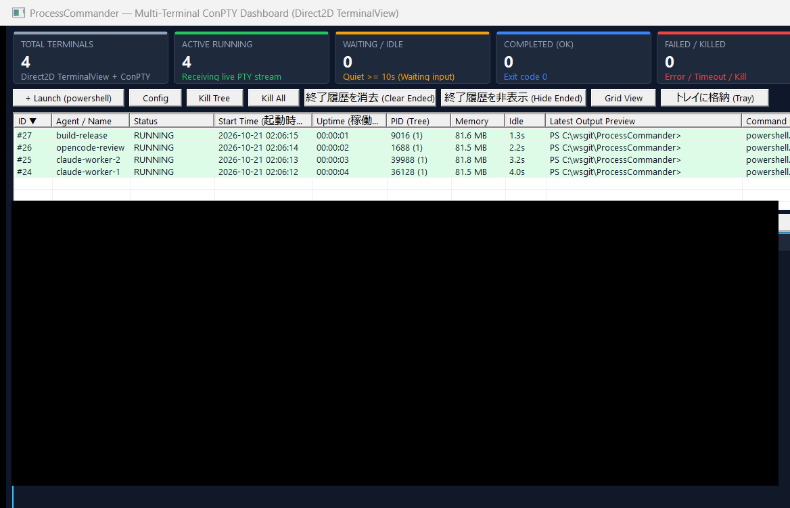
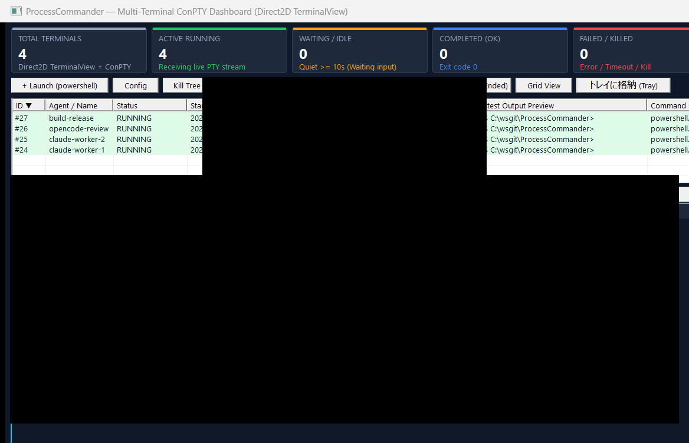

# ProcessCommander

**[English](README.md) | [日本語 (Japanese)](README-ja.md)**

**ProcessCommander** is a native Win32 C++ Multi-Terminal ConPTY Process Manager and Dashboard designed for orchestrating, monitoring, and interacting with multiple parallel CLI agents (`claude`, `opencode`, build scripts, and interactive shells) via both **Model Context Protocol (MCP)** and **CLI commands**.



---

## Key Features

### 1. Native Win32 + Direct2D Multi-Terminal Dashboard GUI
- **6 Top KPI Summary Cards**: Real-time metrics for Total Terminals, Active Running, Waiting/Idle (`>= 10s`), Completed (`Exit 0`), Failed/Killed, and Total Job Object Memory & Process Count.
- **Sortable Process Summary Table (Newest on Top)**:
  - Newly launched processes are automatically added to the **top of the list** (`ID ▼` descending by default).
  - Click **any column header** (`ID`, `Agent / Name`, `Status`, `Start Time`, `Uptime`, `PID (Tree)`, `Memory`, `Idle`, `Latest Output Preview`, `Command Line`) to toggle **Ascending (`▲`) / Descending (`▼`)** sort order.
- **Tab-Switched Full-Size Direct2D Terminal (`>= 80x25`)**:
  - Embedded hardware-accelerated Direct2D / DirectWrite / IME / Sixel VT terminal emulator (`TerminalView` + `ConPtySession`).
  - Switch between active terminals using the **Terminal Tab Bar** while always preserving at least **80 columns × 25 rows** of terminal viewport so TUI apps (`claude`, `opencode`, `vim`, `htop`) never wrap or corrupt their layout.
  - Type directly into the terminal (full keyboard input, `Ctrl+C`, IME composition, mouse wheel scrollback, and text selection).
- **Up to 16 Parallel Terminals in Live Grid View (`[Grid View]`)**:
  - Click **`[Grid View]`** to open a live DWM thumbnail & snapshot grid (up to **16 parallel terminals** in a `4×4` matrix). Click any cell or use arrow keys + Enter to jump directly to that terminal tab.



### 2. Multi-Shell Launcher & `[Config]` Dialog (`cmd` / `powershell` / `bash`)
- Click **`[+ Launch (...)]`** on the toolbar to immediately spawn a new interactive ConPTY terminal tab.
- Click **`[Config]`** to select the default shell (`cmd`, `powershell`, or `bash` — auto-detecting Git Bash / WSL Bash), customize startup command lines, or launch any shell on the spot. Settings are persisted in `logs/config.json`.


### 3. History Management & Task Details Dialog
- **`[終了履歴を消去 (Clear Ended)]`**: Deletes all completed/killed/failed process entries from history and updates `logs/processes_state.json`.
- **`[終了履歴を非表示 (Hide Ended)]`**: Toggles hiding/showing finished processes so you can focus exclusively on currently running tasks without deleting history.
- **Right-Click Context Menu & Task Details Dialog**: Right-click any process row or terminal tab (or double-click a row) to inspect the full command line, working directory, PID/Job metrics, log file path, `.done` file path, and output preview, or copy the command line to the clipboard.

### 4. System Tray Integration
- Click **`[トレイに格納 (Tray)]`**, minimize the window, or press the window close button (`[X]`) to hide ProcessCommander into the **Windows System Tray** while keeping all background ConPTY processes and IPC/MCP services running.
- Left-click or double-click the tray icon (or right-click to open the tray menu) to restore and expand the dashboard at any time.

### 5. Persistent Logs, State Recovery & `.done` Completion Marker Files
- **Real-Time Per-Process Logs**: Every process's stdout/ConPTY stream is continuously written to `logs/proc_<id>_<name>_<YYYYMMDD_HHMMSS>.log` (or a custom `--log-file <path>`).
- **Completion Marker Files (`.done`) for AI Agents**: On process exit, ProcessCommander atomically writes a JSON completion file (`logs/proc_<id>.done` or custom `--done-file <path>`), allowing Claude or automation scripts to detect task completion via simple file-existence checks.
- **State Persistence Across Restarts**: Process metadata and history are saved in `logs/processes_state.json` and automatically restored when ProcessCommander starts.

### 6. Reliable Win32 Job Object Process Tree Control
- Each process runs inside a dedicated Win32 `Job Object` (`JOB_OBJECT_LIMIT_KILL_ON_JOB_CLOSE`), tracking all child/grandchild processes and memory usage and guaranteeing clean tree termination on `kill`, `--timeout`, or `--idle-timeout`.

---

## Build Instructions

Requires Windows 10/11 (x64), Visual Studio 2022 (C++17), and CMake 3.20+:

```powershell
cmake -B build -G "Visual Studio 17 2022" -A x64
cmake --build build --config Release
```

Output binary: `build/Release/ProcessCommander.exe` (alongside `conpty.dll` and `OpenConsole.exe`).

---

## Usage 1: CLI Commands

All CLI commands communicate with the running GUI Dashboard via Named Pipe (`\\.\pipe\ProcessCommander_IPC_v1`). If the dashboard is not yet running, it is launched automatically.

```powershell
# Launch the GUI Dashboard (or restore from System Tray if already running)
ProcessCommander.exe gui

# Start an interactive ConPTY process with custom log and .done marker file
ProcessCommander.exe start --name "agent-task" --mode pty --cmd "opencode run \"Fix issue #42\"" --log-file "C:/logs/task42.log" --done-file "C:/logs/task42.done"

# List all managed processes (JSON)
ProcessCommander.exe list

# Read the latest 80 lines of clean output from process #1
ProcessCommander.exe logs --id 1 --tail 80

# Send input to process #1's ConPTY / stdin
ProcessCommander.exe send --id 1 --input "y"

# Wait for process #1 to finish (up to 30 seconds)
ProcessCommander.exe wait --id 1 --wait-ms 30000

# Kill a process tree or all running processes
ProcessCommander.exe kill --id 1
ProcessCommander.exe kill-all

# Clear finished process history
ProcessCommander.exe clear
```

---

## Usage 2: MCP Server for Claude Code / Claude Desktop

Add `ProcessCommander.exe` to your `.mcp.json` or `claude_desktop_config.json`:

```json
{
  "mcpServers": {
    "process-commander": {
      "command": "C:/wsgit/ProcessCommander/build/Release/ProcessCommander.exe",
      "args": ["mcp"]
    }
  }
}
```

### Provided MCP Tools
| Tool Name | Description |
| :--- | :--- |
| `start_process` | Start a process (`cmd`, `name`, `mode` [`pty`\|`pipe`\|`console`], `cwd`, `log_file`, `done_file`, `timeout_sec`, `idle_timeout_sec`, `wait`, `wait_ms`) |
| `list_processes` | List all managed processes with status, start time, uptime, PID tree count, memory, log/done paths, and latest output line |
| `get_process_output` | Retrieve ANSI-stripped or raw terminal output for a process (`id`, `tail_lines`, `clean_ansi`) |
| `send_process_input` | Send text input or commands to a running process's ConPTY / stdin (`id`, `input`, `append_newline`) |
| `wait_process` | Wait for a process to exit (`id`, `wait_ms`) |
| `kill_process` | Terminate a specific process tree (`id`) or all running processes (`kill_all: true`) |
| `focus_process_window` | Focus the terminal tab or console window of a process (`id`) |
