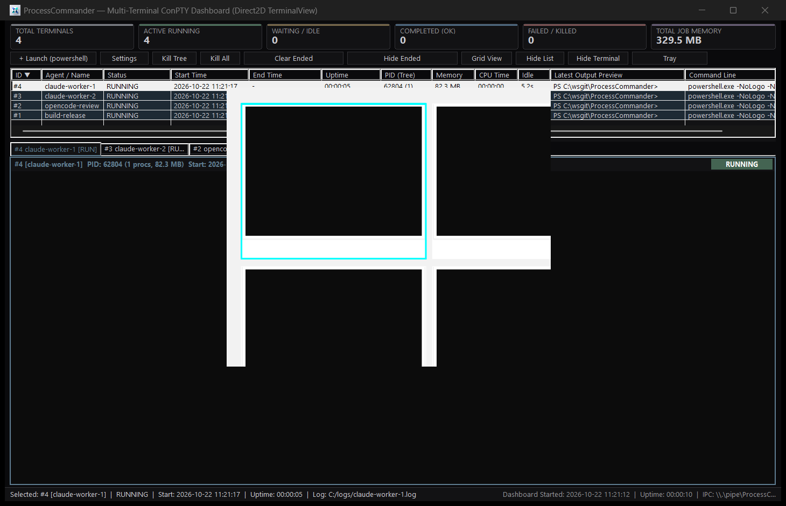
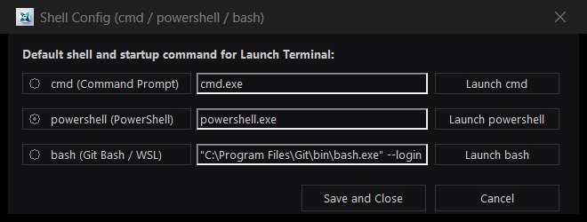

# 主な特徴

**[English](features.md) | [日本語 (Japanese)](features-ja.md)**

## 1. 一覧性と操作性を両立した Native Win32 + Direct2D ダッシュボード GUI
- **上部 KPI サマリーカード (2行・計14枚: プロセス & タスク)**:
  - **省スペース横並びレイアウト**: ラベルと数値を同一行に横並び配置し、ヘッダ高さを大幅短縮。プロセス一覧やターミナルの表示領域を最大化。
  - **上段 (プロセス)**: 管理ターミナル/プロセス総数、稼働中 (`ACTIVE RUNNING`)、入力待ち/アイドル (`WAITING / IDLE >= 10s`、出力もCPU消費もない場合)、正常完了 (`COMPLETED`)、失敗/強制終了 (`FAILED / KILLED`)、**最短残り時間** (最も期限が近いプロセスの残り秒数カウントダウン表示)、全 Job Object の合計メモリ使用量・プロセスツリー数をリアルタイム表示。
  - **下段 (タスクキュー)**: タスク総数、稼働中タスク (`RUNNING`)、待機/保留中タスク (`WAITING / PENDING`)、成功タスク (`SUCCEEDED`)、失敗タスク (`FAILED`)、**最短残り時間** (最も期限が近いタスクの残り秒数カウントダウン表示)、アクティブキュー数 & 最大並列度をリアルタイム表示。
  - 各カードにマウスカーソルを合わせると内訳ツールチップを表示。
- **2行スタック表示 & ドラッグ可能なスプリッター (プロセス一覧 ＋ タスクキュー一覧)**:
  - プロセス状況一覧（上段）とタスクキュー一覧（下段）を上下2段で同時に表示。各リストの上に **「プロセス」「タスクキュー」のキャプション** が付き、どちらがどちらか一目で分かります。
  - 境界線のスプリッターバーをマウスドラッグして各領域の高さを自由に調整可能。
  - ツールバーの表示切替ボタン（または **Ctrl+T**）で **2行同時表示 (Two Rows)** → **プロセスのみ (Processes Only)** → **タスクのみ (Tasks Only)** を順次トグル切り替え。
- **全プロセス状況リスト（新しい順・全カラムソート対応）**:
  - 新しく起動したプロセスほど**リストの一番上**に追加されます（デフォルト: `ID ▼` 降順）。
  - リスト上部の**任意のカラムヘッダ**（`ID`, `Windows PID`, `Agent / Name`, `Status`, `Start Time (起動時刻)`, `End Time (終了時刻)`, `Uptime (稼働時間)`, `Tree Procs (ツリー内プロセス数)`, `Memory`, `CPU Time`, `Idle`, `Latest Output Preview`, `Command Line`, `Job`）をクリックすると、**昇順 (`▲`) / 降順 (`▼`)** で自在にソートを切り替えられます。
  - `ID` は ProcessCommander 内部の番号、`Windows PID` は OS 上のルートプロセスの PID です。タスクマネージャ等で目的のプロセスをすぐ特定できます。
  - **CPU 消費を考慮したアイドル判定**: CPU 時間が増え続けているプロセスは `RUNNING` として扱い、`IDLE / WAITING` 表示にせず、`--idle-timeout` の対象にもしません。CPU 時間は Win32 Job Object ツリー全体の合計です。
- **タブ切り替え式フルサイズ Direct2D ターミナル (`80桁×25行以上保証`)**:
  - Direct2D / DirectWrite / IME / Sixel 対応のフル VT ターミナルエミュレータ（`TerminalView` + `ConPtySession`）を搭載。
  - ターミナル領域上部の**タブバー**で表示するターミナルを切り替え、常に **80桁×25行以上** のコンソールサイズを確保するため、TUI アプリケーション（`claude`, `opencode`, `vim` 等）の表示崩れが起きません。
  - ターミナル画面内を直接クリックしてキー入力・`Ctrl+C`・日本語 IME 変換・マウスホイールスクロール・範囲選択コピーが可能です。
- **最大16並列対応のライブグリッドビュー (`[▦]`)**:
  - ツールバーの **`[▦]`** ボタンをクリックすると、並列稼働中のターミナル（最大16個・4×4グリッド）をサムネイル一覧表示します。任意のセルをクリック（または矢印キー＋Enter）すると、該当ターミナルのタブへ即座に切り替わります。
- **コンパクトなアイコンボタンとホバーツールチップ**:
  - **`[▦]`** グリッド表示の切り替え
  - **`[☰]`** プロセスリストの表示/非表示切り替え
  - **`[>_]`** ターミナルパネルの表示/非表示切り替え
  - **`[⤓]`** タスクトレイに格納
  - ツールバーの各アイコンボタンに状態対応のホバーツールチップが設定されています。

## 2. `[Config]` ボタンによるシェル起動設定 (`cmd` / `powershell` / `bash`)
- ツールバーの **`[+ Launch (...)]`** ボタンで、設定中のデフォルトシェルを即座に ConPTY タブとして起動します。
- **`[設定]`** → **`[シェル構成...]`** からシェル設定ダイアログを開き、**`cmd`** (`cmd.exe`)、**`powershell`** (`powershell.exe`)、**`bash`** (`Git Bash` / `WSL`) のデフォルト切り替え・起動コマンドの編集・その場での個別起動が可能です（設定は `logs/config.json` に永続化されます）。

## 3. 終了履歴の管理、タスク詳細・LLM JSON ツリービューア
- **終了履歴を非表示** (設定ダイアログ): 設定ダイアログのチェックボックスで、履歴データを消さずに終了したプロセスをリスト・タブから非表示にして「実行中のプロセスのみ」を絞り込み表示できます。
- **`[終了履歴を消去]` & `[プロセスIDをリセット]`** (設定ダイアログ): 完了・強制終了したプロセスの履歴消去や、プロセスIDの再付番を実行できます。
- **右クリックメニュー & タスク詳細ダイアログ**:
  - リストの行またはタブを**右クリック**（または行をダブルクリック）すると、**「ツリー終了 (Kill Tree)」**（確認ダイアログ付き）、詳細表示、コマンドラインコピー、ログ/ストリームファイル閲覧、履歴削除を実行できます。
- **LLM JSON ストリーミング出力対応 & JSON ツリービューア**:
  - 主要 AI コーディングエージェント (`claude`, `agy`, `opencode`, `codex`) の JSON ストリーミング出力を自動検知・パースし、通常のコンソールログに加えて構造化 `.stream.jsonl` ファイルへリアルタイム記録。
  - タスク詳細ダイアログに `nlohmann/json` 採用の **JSON ツリービューア** を統合。生の JSONL 行を追うことなく、階層構造（オブジェクト、配列、ツール呼び出し引数、思考ブロック、トークン消費量など）を展開・折りたたみしながら整理されたツリー形式で直感的に確認・検証可能。
- **実行状態監視ペイン (Execution Monitor Pane)**:
  - プロセス一覧／タスクキュー一覧の下に表示されるペインで、**選択中のプロセスに追従**します。`{}` ボタンまたは右クリックメニューの「JSON ストリームをボトムペインに表示」で表示を切り替えられ、上のドラッグバーで高さを変更できます。表示状態と高さは `logs/config.json` に保存されます。
  - **目標**: プロセスのゴール（またはジョブを起動したタスクキューの summary）。
  - **現状**: エージェントが今何をしているかを経過時間付きで表示（例: `✏️ ファイルを編集している src/a.cpp (1m20s)`）。
  - **終わり**: エージェント自身の TODO 進捗（`3/7 done: ...`）、ジョブの成功条件、現在の試行回数、制限時間と残り時間、無出力で打ち切るまでの時間。
  - **活動履歴**: 生の JSON イベントではなく、1 ステップ 1 行の平易な履歴（開始時刻・所要時間・何をしていたか・対象のファイルやコマンド）。実行中の行は 1 秒ごとに時間が更新され、行を選ぶと生の JSON を確認できます。
  - 活動種別（ファイル読み込み、ファイル編集、検索、コマンド実行、Web、サブエージェント、計画更新、その他ツール、思考、回答作成、モデル応答待ち）を色分けし、アイコン付きで表示します。実行中の行と長時間かかったステップは背景色で強調されます（設定で色分けとアイコンをまとめてオフにできます）。
  - JSON ストリーミングを行うプロセスはプロセス一覧で `{}` が付き、プレビュー列にも「今何をしているか」が経過時間付きで表示されます。
  - **イベント保持件数の設定**（設定画面の「プロセスごとの保持イベント数」）: プロセスごとにメモリに保持するストリームイベントの数です。既定は 2000 で、100〜100000 の範囲に収まります（0 や他の負の値は 100 になります）。`-1` は、メモリが足りなくなるまですべて保持します。メモリが足りなくなった場合は、そのプロセスの古い方の半分を捨て、監視ログに記録します。設定は実行中のプロセスの次のイベントから反映され、`logs/config.json` に保存されます。
- **Claude サブエージェント対応**: `Agent` 呼び出しとそのサブエージェントの動きをストリーム状態（`subagents`: 親エージェント id、状態、トークン数、ツール回数）として追跡します。監視ペインでは、サブエージェントごとに枝を表示し、その下に動きを時系列（古い行が上、実行中の動きが下）で並べます。枝は完了の 3 秒後に閉じます（失敗した場合や実行中の動きが残っている場合は開いたまま）。▶/▼ をクリックするか、選択して左右キーを押すと手動で開閉できます。リストは再描画しても選択位置を保ち、一番下を見ている間は実行中の動きに追従します。サブエージェントがない実行では、今までどおり新しい行が上に並びます。`pcder agent status` と JSON ストリームでも見えます。
- **Claude サブエージェント用ヘルパー (`pc-runner`)**: `pcder agent install-template` が `.claude\agents\pc-runner.md` を書きます。長いビルドやテストを ProcessCommander 経由で実行し、要約だけを返す Claude Code のサブエージェントです。

## 4. タスクトレイ格納・復元対応
- ツールバーの **`[⤓]`**（トレイ格納アイコンボタン）、最小化ボタン、またはウィンドウ右上の閉じるボタン（`[X]`）で、バックグラウンドで全プロセスと IPC/MCP 通信を維持したまま **タスクトレイ（通知領域）** に格納されます。
- タスクトレイアイコンの**左クリック / ダブルクリック**（または右クリックメニュー）でいつでも元の画面に拡大・復元できます。完全に終了する場合はトレイアイコンの右クリックメニューから「ProcessCommander を完全終了 (Exit)」を選択します。

## 5. リアルタイムログ保存・状態復元・完了検知 `.done` ファイル出力
- **プロセス別リアルタイムログ**: すべてのプロセスの出力は `logs/proc_<id>_<name>_<YYYYMMDD_HHMMSS>.log`（または `--log-file <path>`）にリアルタイム保存されます。
- **完了検知用 `.done` マーカーファイル**: プロセス終了時に `logs/proc_<id>.done`（または `--done-file <path>`）へ終了コード・稼働時間・ログパスを含む JSON をアトミックに出力します。Claude 等からファイルの存在チェックだけで確実に終了を検知できます。
- **再起動時の状態復元**: プロセス一覧と終了履歴は `logs/processes_state.json` に自動保存され、次回起動時に復元されます。

## 6. 設定ダイアログ・テーマ・ローカライゼーション
- **`[設定]`** ボタンで設定ダイアログを開きます。
- **言語**: **日本語 / English / Español** ボタンで即座に切り替え。ダッシュボード、ダイアログ、メニュー、ステータスバーが連動します。
- **テーマ (色)**: **Windows**（既定。Windows のライト/ダークモードと個人設定のアクセントカラーに追従）、**ダーク**、**ライト**、**ハイコントラスト**、**パステル**、背景が淡色の **パステル青 / 橙 / 桃 / 赤 / 緑**、**濃い紫 / 薄い紫**、**濃い黄 / 薄い黄**、および深夜、残り火、ベリー、クリムゾン、深緑、ミストから選択。ボタン、リストヘッダ（プロセスリスト・ジョブリスト両方）、スクロールバー、タブラベルも選択中のテーマ色に沿って統一描画されます。
- **`[シェル構成...]`**、**`[プロセスIDをリセット]`**、**`[終了履歴を消去]`**、および **「終了履歴を非表示」**、**「実行状態監視ペイン: 行を色分けし、アイコンを表示」** チェックボックスは設定ダイアログ内に集約されています（ツールバーをすっきりと整理）。
- 設定・言語・テーマ・リスト/ターミナルの表示状態・レイアウトは `logs/config.json` に自動保存され、次回起動時に復元されます。

## 7. タスクキュー: 順序・依存・タイムアウト・自動再実行
- ジョブを**1 コマンドずつ**登録すると、ProcessCommander が実行順・同時実行数・優先度を決め、キューを永続化します（`logs/taskqueues/<name>.json`）。
- ジョブ単位の `timeoutSec`、出力と CPU の両方を見るアイドル検出、成功条件（`exitCode` / `filesNewer` / `outputRegex`）、自動再実行（`maxAttempts`）、依存失敗時の `blocked` を提供します。
- **ChainGuard** が `start_process` / `taskqueue_add` / `taskqueue_update` のシェル連鎖と待ちループを拒否します。順序は `dependsOn` で宣言してください。CLI の `--allow-chain` のみ例外（MCP には非公開）。
- GUI: 左端の表示切替ボタン、または **Ctrl+T** で **2行同時表示 (Two Rows)**、**プロセスのみ (Processes Only)**、**タスクのみ (Tasks Only)** を順次トグル切り替え。2行表示時は水平スプリッターバーをドラッグして各領域の高さを自在に調整できます。実行中のジョブは上位に表示され、失敗は低彩度の赤、タイムアウトは低彩度のアンバーで表示されます。
- 詳細は [タスクキュー](taskqueue-ja.md) を参照。
